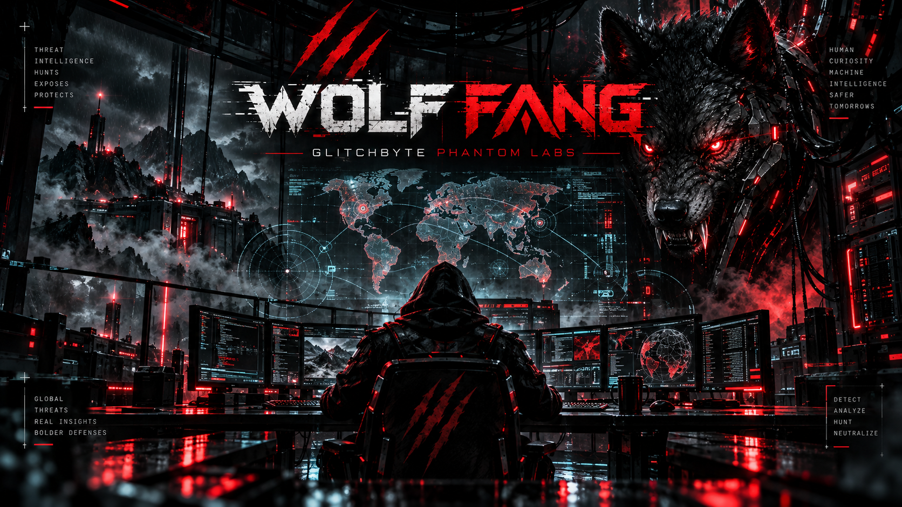

# 🐺 WOLF FANG v0.1.3 // FANG VISION

<!-- GLITCHBYTE-VISITOR-BADGE:START -->
[](https://github.com/Hellfire13666/wolf-fang-glitchbyte-2026)
<!-- GLITCHBYTE-VISITOR-BADGE:END -->



**VISUAL EDITION:** The approved wolf-ops artwork is included in `assets/`, and each HTML report embeds a compact WOLF FANG banner directly. It remains completely readable offline, including if you move the HTML to another folder or computer. The original JSON and CSV reports are unchanged.

**GLITCHBYTE PHANTOM LABS · FANG TRACE · ASN CLAW · HONEYPOT SENTINEL · FANG VISION**

An IP intelligence workstation in Python 3.10+ for Ubuntu/Linux. Single target IP per run, standard-library-only code, locally stored results, no exploit or account-bypass components.

## Quick launch: simple Linux copy/paste

Download `WOLF-FANG-GLITCHBYTE-PHANTOM-LABS-v0.1.3.zip` to `~/Downloads`, then paste:

```bash
cd "$HOME/Downloads" &&
unzip -oq WOLF-FANG-GLITCHBYTE-PHANTOM-LABS-v0.1.3.zip &&
cd wolf-fang-v0.1.3 &&
./RUN_TESTS.sh &&
./OPEN_WOLF_FANG.sh --doctor &&
./OPEN_WOLF_FANG.sh --demo
```

The SHA256 checksum file is optional to download **separately**. If you saved it alongside the ZIP, verify **before** unzipping with:

```bash
cd "$HOME/Downloads"
sha256sum -c WOLF-FANG-GLITCHBYTE-PHANTOM-LABS-v0.1.3.zip.sha256
```

The installation does **not** require an API key or `pip install`.

## Your first real lookup (passive sources only)

```bash
cd "$HOME/Downloads/wolf-fang-v0.1.3"
./OPEN_WOLF_FANG.sh 1.1.1.1 --live
```

The default uses **seven sources previously confirmed working on the user's Ubuntu machine**: `rdap,ripe,internetdb,ipwhois,ipinfo,dns,ipapiis`. HTTPS timeout defaults to **20 seconds per request**, based on user's successful IPapi.is test. A successful provider in previous runs can still become temporarily unavailable. Results are not guaranteed.

Optional, fewer sources for a slower connection:

```bash
./OPEN_WOLF_FANG.sh 1.1.1.1 --live --providers rdap,ripe,ipapiis --timeout 20
```

To include the new optional AlienVault OTX community indicator lookup:

```bash
./OPEN_WOLF_FANG.sh 1.1.1.1 --live --providers rdap,ripe,otx --timeout 20
```

**OTX is documented but has not yet been live-tested on the user's machine.** Anonymous general-indicator data may be available; an API key or account may be required for some usages. An HTTP error will be reported, not bypassed. Community pulse counts and reputation indicators are *not proof of malicious behavior*.

`--providers all` requests every adapter, including GreyNoise and AbuseIPDB. GreyNoise previously timed out from the user's system and AbuseIPDB requires a key; neither is enabled in the normal seven-source profile.

List providers: `./OPEN_WOLF_FANG.sh --list-providers`.

## 👁 FANG VISION dashboard

**New reports** save as JSON + CSV + **rich HTML dashboard** under `~/WolfFangReports`. No browser extensions, remote image requests, tracking, JavaScript, or online dashboard hosting. The fixed local cover image is embedded directly in each HTML report.

**View your newest WOLF FANG report** (supports original v0.1.0, v0.1.1 and new JSON):

```bash
./OPEN_FANG_VISION.sh --open
```

**Render a specific earlier report** (without scanning again):

```bash
./OPEN_FANG_VISION.sh --file "$HOME/WolfFangReports/WOLF-FANG-EXAMPLE.json" --open
```

Replace `WOLF-FANG-EXAMPLE.json` with the actual file name. `--open` is optional: if it cannot open the browser, the printed local HTML path can be opened in Firefox manually. Reports imported with FANG VISION are never overwritten. Generated dashboards go to `~/WolfFangDashboards`, separate from raw reports.

The dashboard includes a summary, network-owner hints, ASN, provider success and failures, latency, honeypot public-tag evidence, indexed ports and published hostnames. It distinguishes synthetic demonstrations from live results and repeatedly states that locations, IP ownership, indexed ports, and third-party threat reports are **not proof about individuals or live service exposure**.

## Optional keys

```bash
./CONFIGURE_KEYS.sh
./OPEN_WOLF_FANG.sh --doctor
```

Choose key(s) only from providers you independently registered with. **Press Enter** for missing/unused keys; `IPINFO_TOKEN`, `GREYNOISE_API_KEY`, `ABUSEIPDB_API_KEY`, and `OTX_API_KEY` are optional. Secrets save outside the repository at `~/.config/wolf-fang/keys.env` with owner-only (`0600`) permissions. Never paste keys into ChatGPT, screenshot them, or commit them to GitHub.

## Source reference and limits

| Adapter | Operator | Role | Key | Caveat |
|---|---|---|---|---|
| `rdap` | RDAP registry redirect | Registration and admin contacts | No | Registration is not the IP user's identity |
| `ripe` | RIPEstat | Prefix, ASN, registered abuse contact | No | Network routing data |
| `ripestatus` | RIPEstat RIS | Route visibility | No | Seen by collectors; not reachability |
| `internetdb` | Shodan InternetDB | Indexed ports, hostnames, tags and possible CVE associations | No | Historical and incomplete; not a live scan |
| `ipwhois` | ipwho.is | ISP and approximate geolocation | No | Approximate, not an address |
| `ipinfo` | IPinfo | Domain/PTR and network hints | Optional | Provider may apply quotas |
| `dns` | OS DNS | PTR and forward-confirmation | No | DNS records can change |
| `ipapiis` | IPapi.is | ASN/ownership/geolocation | No for anonymous | Anonymous tier rate limits; no premium risk flags |
| `otx` | AlienVault OTX | Community pulses/reputation | Optional | Community submissions can be incorrect; anonymous access may be limited |
| `greynoise` | GreyNoise Community | Scanning classification | Optional | Timed out on user's network; no honeypot certainty |
| `abuseipdb` | AbuseIPDB | Crowdsourced abuse reports | Yes | Reports are not verified guilt |

Source docs: [RIPEstat](https://stat.ripe.net/docs/data-api/ripestat-data-api) · [OTX Python SDK](https://github.com/AlienVault-OTX/OTX-Python-SDK) · [AlienVault OTX](https://otx.alienvault.com/api/)

**Passive** means this tool queries external APIs with the target IP: it is **not invisible** to those API providers. Private, reserved and non-global addresses are never sent to public lookups. Active TCP checks for owned or explicitly authorized IPs retain the existing exact-IP scope/consent gate and a 16-port cap. No exploitation, auth bypass, stealth, credential collection, or honeypot evasion.

## Built-in repair shop

```bash
./RUN_TESTS.sh
./OPEN_WOLF_FANG.sh --doctor
./OPEN_WOLF_FANG.sh --help
./OPEN_FANG_VISION.sh --help
```

Keep `~/WolfFangReports` and `~/WolfFangDashboards` private. The older `wolf-fang-v0.1.0`, `wolf-fang-v0.1.1` and `wolf-fang-v0.1.2` install folders are left untouched by the new ZIP.

**WOLF FANG // GLITCHBYTE PHANTOM LABS // 2026**


## GitHub-ready visual identity

Use `assets/wolf-fang-repo-cover.png` as the full-width README header, `assets/wolf-fang-emblem.png` as the repo's social/announcement poster, and `assets/wolf-fang-command-center.png` as the wide screenshot/banner. These are original project visuals. The GitHub README links to the *local* `assets/` images and works once you commit those images with the source. See [`GITHUB_BRANDING.md`](GITHUB_BRANDING.md) for safe publish commands and privacy notes.

## Release publication

For GitHub publication and a draft v0.1.3 release, see [GITHUB_PUBLISH_GUIDE.md](GITHUB_PUBLISH_GUIDE.md). First run `./RELEASE_CHECK.sh`. Publication is never automatic. No personal reports or API keys belong in the source repository.
